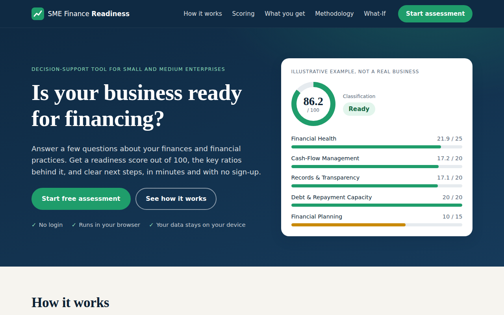
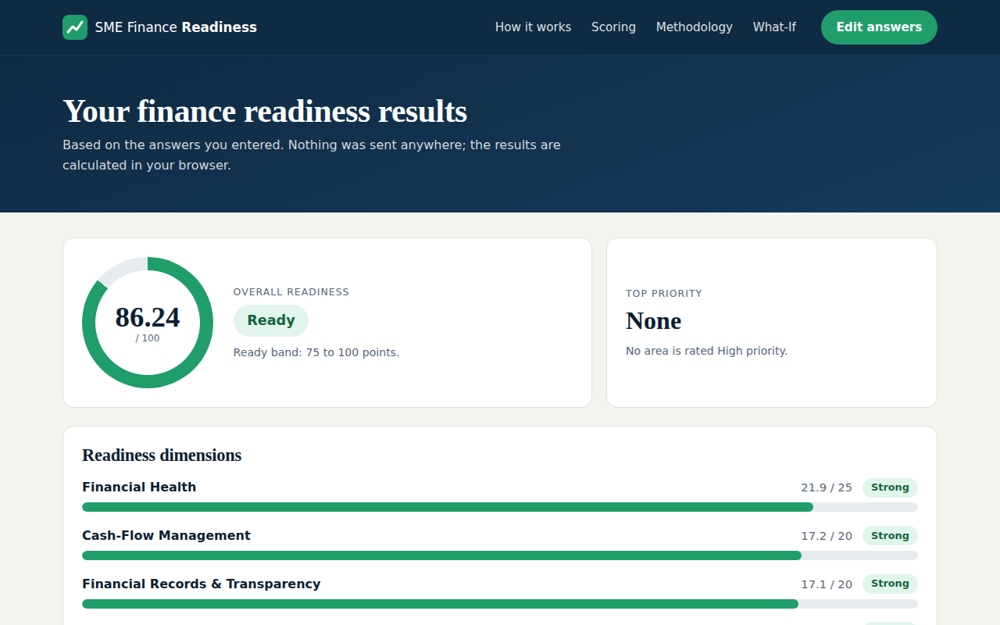
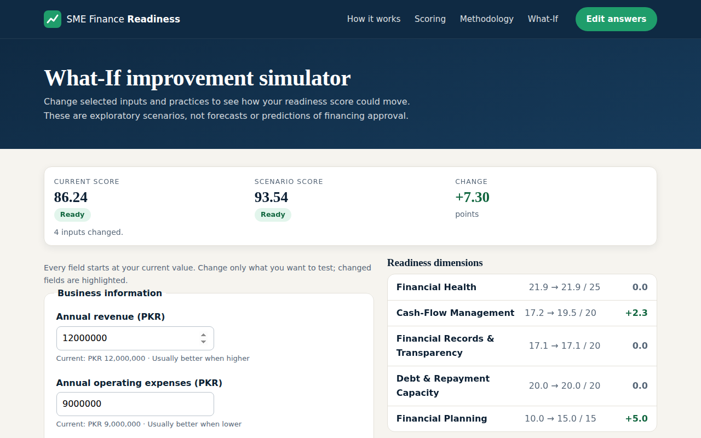

# SME Finance Readiness & Improvement Simulator

A browser-based decision-support prototype that gives a small or medium enterprise (SME) a **finance readiness score out of 100**, the key ratios behind it, rule-based improvement recommendations, and a **What-If simulator** for testing improvements. It runs entirely in the browser: no login, no server, no data leaves the device.

> **Educational prototype.** The score is an internally designed readiness index. It is **not** a credit score, not financial advice, and not a prediction of loan or financing approval. Weights and thresholds are design choices that have not yet been empirically validated.

**Live demo:** [https://zunairaftm.github.io/smefinancereadinesssimulator/](https://zunairaftm.github.io/smefinancereadinesssimulator/)



## Features

- **Assessment form:** 29 inputs across business information, cash flow, financial records and financial planning, with validation and a one-click demo dataset.
- **Readiness dashboard:** overall score, classification (Ready / Developing / Needs Improvement), 5 weighted dimensions and 8 key indicators.
- **Rule-based recommendations:** each area is rated High, Medium or Low priority with a recommended action, a next step and why it matters.
- **What-If simulator:** change financial inputs or practices and compare current vs. scenario score, dimensions and indicators side by side.
- **Printable report:** one-click print or Save as PDF of the results.
- **Built-in verification page:** `tests.html` runs the automated checks in the browser.

| Results dashboard | What-If simulator |
|---|---|
|  |  |

## How the score works

The 100 points are split across five dimensions made of nine scored components (ported from the original Excel model).

| Dimension (max points) | Component | Max | How points are earned |
|---|---|---|---|
| Financial Health (25) | Liquidity | 8 | Current ratio, linear from 0 to 2 |
| | Profitability | 9 | Operating profit margin, linear from 0% to 20% |
| | Leverage | 8 | (1 − debt/assets) ÷ 0.8 × 8, kept between 0 and 8 |
| Cash-Flow Management (20) | Cash-flow coverage | 10 | Inflow ÷ outflow, linear from 0 to 1.5 |
| | Cash reserve | 5 | Months of reserve, linear from 0 to 3 |
| | Monitoring frequency | 5 | Monthly 5, quarterly 3, less often 1 |
| Financial Records & Transparency (20) | Recordkeeping | 20 | Share of 7 practices answered "Yes" |
| Debt & Repayment Capacity (20) | Debt-service coverage proxy | 20 | Cash available ÷ monthly debt payment, linear from 0 to 2 |
| Financial Planning (15) | Planning practices | 15 | Share of 6 practices answered "Yes" |

**Classification:** 75 or more is *Ready*, 50 to 74.99 is *Developing*, below 50 is *Needs Improvement*.

**Recommendation priority** comes from each indicator's status:

| Indicator | Needs attention (High) | Moderate (Medium) | Strong (Low) |
|---|---|---|---|
| Current ratio | below 1.0 | 1.0 to below 1.5 | 1.5 or more |
| Operating profit margin | below 8% | 8% to below 15% | 15% or more |
| Debt / assets | above 50% | above 30% to 50% | 30% or less |
| Cash-flow coverage | below 1.0 | 1.0 to below 1.25 | 1.25 or more |
| Cash reserve | below 1.5 months | 1.5 to below 3 months | 3 months or more |
| Debt-service coverage proxy | below 1.0 | 1.0 to below 1.5 | 1.5 or more |
| Recordkeeping / planning practices | below 60% | 60% to below 85% | 85% or more |

The debt-service measure is a **cash-flow proxy**, not a formal DSCR.

## Verification

- `tests.html` runs 111 automated checks (scoring engine, recommendations, and What-If cases). Open it in a browser; it should report **111 of 111 tests passed**.
- The scoring engine was cross-checked against the original Excel workbook (not included in this repository) by recalculating the workbook for 20 scenarios of the main model and 30 scenarios of its What-If sheet, including zero-denominator and boundary cases. The permanent tests in `js/scoring.test.js` use the workbook's stored demo results and values worked out from its formulas, and `js/whatif.test.js` uses values produced by recalculating the workbook's What-If sheet.
- The user journey (landing, assessment, results, What-If, print) was exercised in headless Chromium. It has **not** been tested on Safari, Firefox or physical phones.

## Known differences and limitations

- **Zero denominators:** if a ratio cannot be calculated (for example current liabilities of 0), the app shows "n/a" and the component earns 0 points. The Excel workbook would label such a case "Strong"; the app deliberately does not.
- **What-If leverage cap:** in the original workbook, the What-If sheet caps debt/assets at 0.8 inside its leverage formula, while the main Scoring sheet does not. The two therefore differ when debt/assets is above 80%. This app uses the main Scoring formula everywhere, so an unchanged scenario always shows a change of exactly +0.00.
- Five inputs (business age, employees, cash, interest expense, principal repayment) are collected for context but not scored, as in the Excel model.
- Results are kept only in the browser tab (`sessionStorage`) and are lost when the tab is closed.
- The index has not been validated against real lending outcomes. Treat it as a learning and discussion tool.

## Run it locally

No build step or dependencies are needed.

1. Download or clone this repository.
2. Open `index.html` in a browser, or serve the folder: `python -m http.server 8000` and visit `http://localhost:8000`.
3. Click **Start free assessment**, then **Load demo data**. The demo dataset should give **86.24, Ready**.

## Project structure

```
index.html          Landing page
assessment.html     Input form
results.html        Results dashboard and print report
whatif.html         What-If simulator
tests.html          In-browser test runner
css/                styles.css, form.css, dashboard.css, whatif.css
js/
  fields.js         Form field definitions and demo data
  scoring.js        Scoring engine (port of the Excel model)
  recommendations.js  Recommendation text and rules
  form.js, dashboard.js, whatif.js   Page logic
  *.test.js         Automated checks
docs/screenshots/   README images
netlify.toml        Optional Netlify settings (the live site is served by GitHub Pages)
```

## Design basis

The design draws on SME-finance literature listed in the original methodology workbook, including OECD (2026) *Financing SMEs and Entrepreneurs 2026*, OECD (2024) *Financing SMEs and Entrepreneurs 2024*, Brijlal, Enow & Isaacs (2014), Kolawole & Oladejo (2026), Okello (2022) and Elom & Atah (2025). The weights, thresholds and bands are transparent design choices informed by that literature, not published standards.

## Author

Built by **Zunaira Fatima**, BBA (Finance), COMSATS University Islamabad, Vehari Campus. [LinkedIn](https://www.linkedin.com/in/zunaira-fatima-111989302) · [GitHub](https://github.com/zunairaftm)

## License

Released under the [MIT License](LICENSE).
